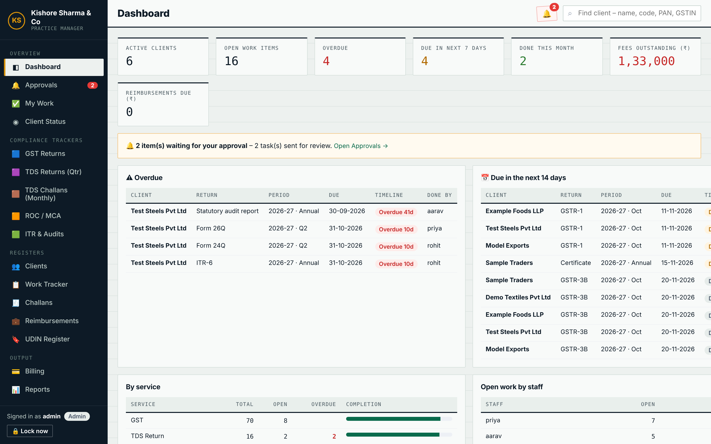
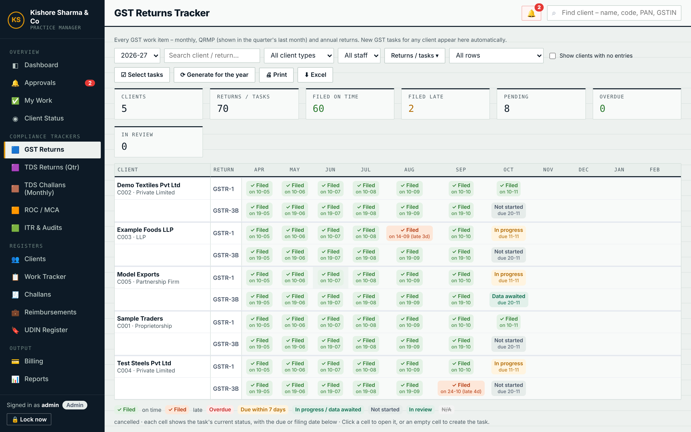
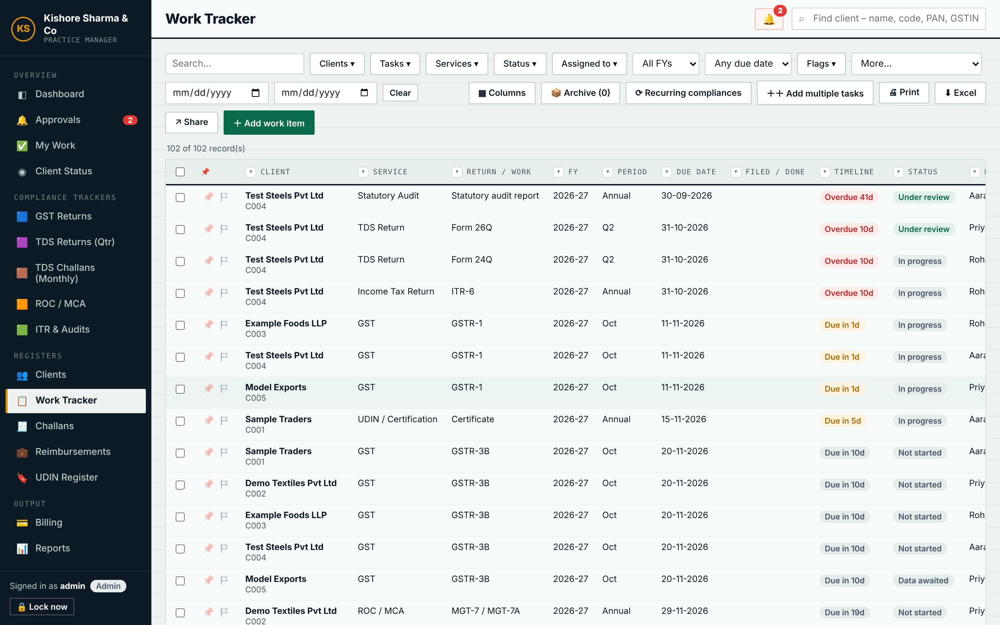
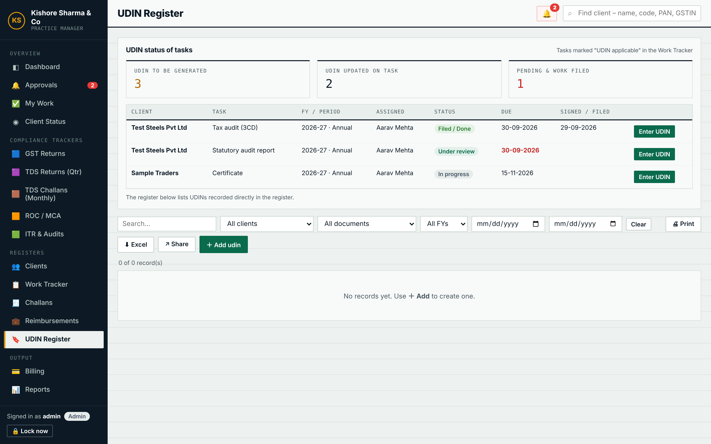
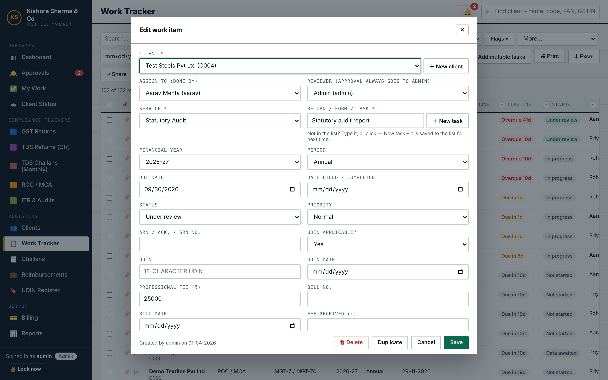
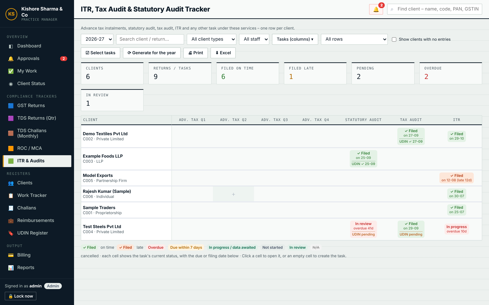
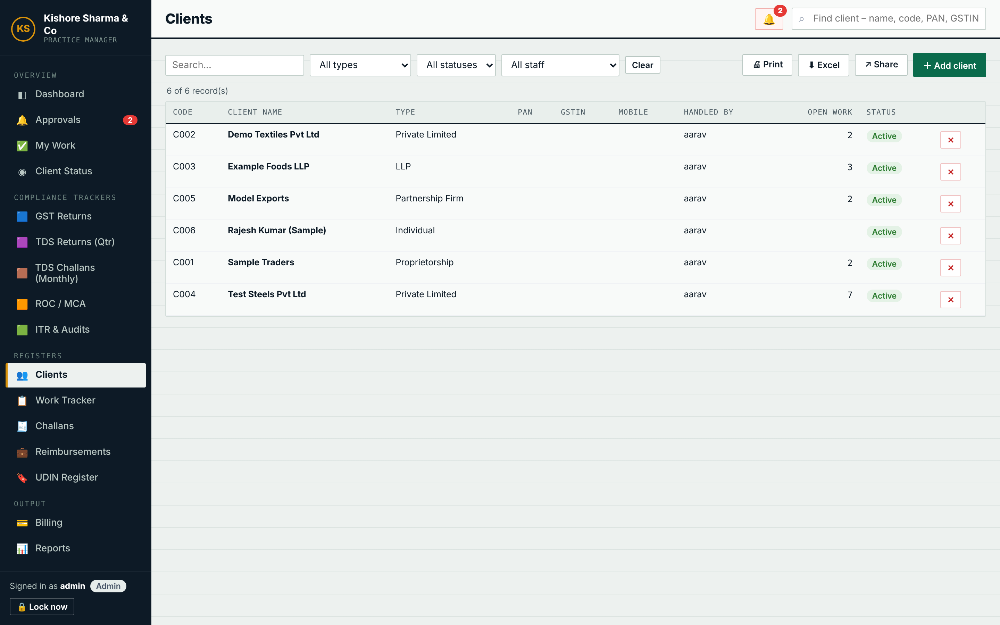
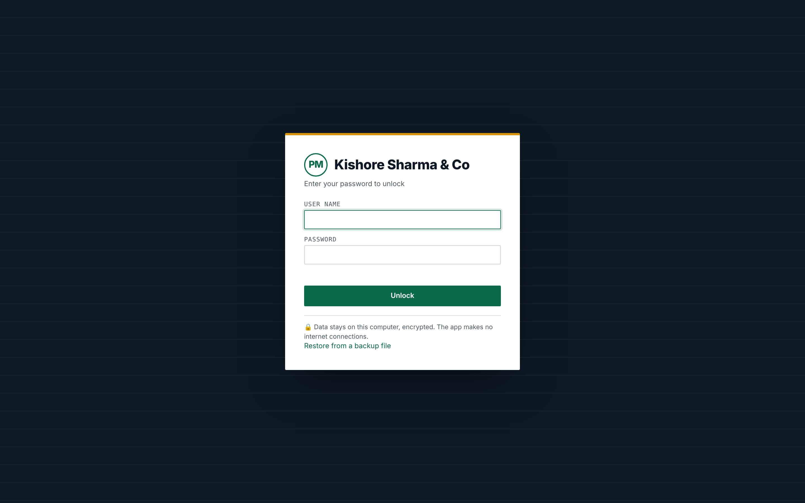

# KSC Practice Manager

**A complete practice management app for Chartered Accountant firms in India — client work, statutory compliance, UDINs, billing and team control, in a single HTML file.**

Built for Kishore Sharma & Co, Chartered Accountants. It runs in any modern browser with no installation, no server and no subscription, and keeps every record encrypted with your password.

> Screenshots use fictional sample clients and staff.

---

## Why it exists

A CA firm runs on deadlines: GSTR-1 on the 11th, GSTR-3B on the 20th, TDS returns every quarter, ITRs, tax audits, ROC filings, and UDINs for every report signed. Spreadsheets lose track of who is doing what and what is overdue. KSC Practice Manager keeps every client, return and due date in one place, shows the whole firm's compliance position at a glance, and makes sure nothing is filed without review.

---

## Features

### Dashboard and daily work
- **Dashboard** with active clients, open work, overdue items, items due in the next 7 days, work done this month, fees outstanding and reimbursements due
- **Overdue** and **Due in the next 14 days** lists, work by service and open work by staff member
- **My Work** view for each staff member with only their own tasks
- **Client Status** view showing where every client stands
- **Global search** by client name, code, PAN or GSTIN

### Compliance trackers
Month-by-month and quarter-by-quarter grids, one row per client, with every cell colour-coded: filed on time, filed late, overdue, due within 7 days, in progress, in review, not started.
- **GST Returns** — GSTR-1, GSTR-3B, QRMP, CMP-08, GSTR-4, GSTR-9 / 9C
- **TDS Returns (quarterly)** — 24Q, 26Q, 27Q, 27EQ
- **TDS Challans (monthly)**
- **ROC / MCA** — AOC-4, MGT-7, ADT-1, DIR-3 KYC, DPT-3, LLP forms
- **ITR & Audits** — advance tax instalments, statutory audit, tax audit, ITR
- **Generate for the year** creates the whole year's recurring returns for selected clients with statutory due dates filled in
- Click any cell to open the task, or an empty cell to create it

### Work Tracker
- Every task with client, service, return / form, FY, period, due date, filing date, status, priority, ARN and fees
- Automatic service detection and **auto-assignment rules** by service or task type
- Due dates filled in automatically for standard returns
- **Recurring compliances** and **Add multiple tasks** for bulk creation
- Duplicate-task warning, notes / updates thread on each task, document attachments
- Custom statuses, services and task types
- Resizable, re-orderable columns; column filters; pins and flags; bulk actions; archive of completed work

### UDIN tracking
- Mark any task as **UDIN applicable**; the UDIN and UDIN date fields appear only then
- Audit and certification work is marked UDIN applicable automatically
- The compliance trackers show **UDIN ✓ with date** or **UDIN pending** on each task
- The **UDIN Register** shows how many tasks are waiting for a UDIN, how many have one, and which are already filed but still missing a UDIN, with one click to enter it
- Separate register for UDINs generated outside a task, with signing date, partner and revocation status

### Registers
- **Clients** — code, type, PAN, GSTIN, TAN, CIN / LLPIN, contacts, group, handled by, agreed fee, services covered
- **Challans** — tax type, head, CPIN / CIN / BSR, mode, amount, paid by client or firm, recovery
- **Reimbursements** — expenses paid for clients, billing and recovery
- **Client statement** showing all work, challans, reimbursements, UDINs and documents of one client

### Billing and reports
- Create bills from completed work, record receipts, track receivables
- Several bill layouts (KSC, classic, modern, minimal) plus your own custom template
- Reports on work, fees, receivables, challans and UDINs for any period
- Print and export to Excel

### Team and control
- **Admin, Staff and Intern** roles with 18 individual rights per user (see all work, assign work, mark as filed, see fees, billing, delete, export and more)
- **Review before filing** — staff without the right can only move work to *Under review*; the Admin approves it
- **Edit window** — a user's own tasks lock after a set time and need Admin approval to change or delete
- **Approvals** inbox with a notification bell
- **Activity log** of every change, and a **Bin** to restore deleted records

---

## Security

- All data is encrypted with **AES-256-GCM**. The key is derived from your password using **PBKDF2-SHA256 with 600,000 iterations**.
- Each user's password unlocks the data key separately; passwords are never stored.
- Auto-lock after a period of inactivity and a lock-out after repeated wrong passwords.
- In offline mode the app makes **no internet connections**; data never leaves the computer.
- **There is no password recovery.** Keep backups.

---

## Getting started

1. Download `index.html`.
2. Open it in **Google Chrome** or **Microsoft Edge**.
3. Enter your firm name, a user name and a strong master password to create the workspace.
4. Add your staff under **Team & Rights**, add clients, then use **Generate for the year** in each tracker.

To use it as a website, enable **GitHub Pages** for this repository (Settings › Pages › deploy from the `main` branch) and open the link it gives you.

### Where your data lives

| Mode | Where data is kept | Who can use it |
|---|---|---|
| Opened from a file or a website (GitHub Pages, your own domain) | Encrypted in that browser on that computer, with an optional linked auto-save file | One computer; several users can log in on it |
| Opened as a Claude artifact | Encrypted in your browser, then stored in the artifact's online workspace | Everyone the owner shares it with |

Use **Settings › Backup** regularly. A backup file can be restored on any computer or moved into the online workspace.

---

## Technology

- One self-contained HTML file: plain JavaScript and CSS, no frameworks, no build step
- Web Crypto API for encryption, IndexedDB for storage
- Works on desktop and mobile browsers

---

## Roadmap

- Shared multi-user hosting on the firm's own domain with a backend (e.g. Supabase)
- Client portal for document upload
- Tally Prime data import

---

## Licence and disclaimer

© Kishore Sharma & Co, Chartered Accountants. All rights reserved unless a licence file says otherwise.

Due dates are general statutory dates and do not account for every CBDT / CBIC / MCA extension. Always confirm against official notifications.
